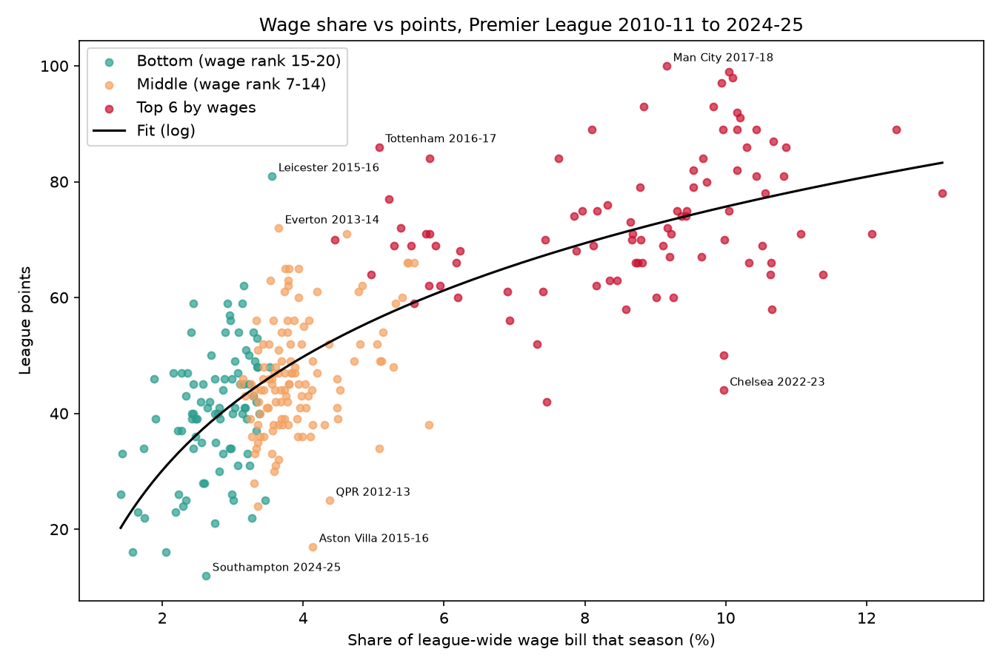
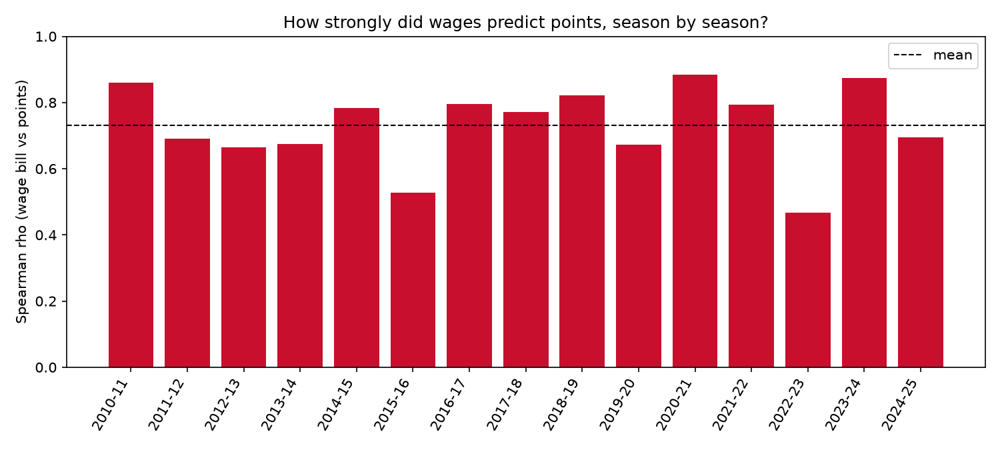
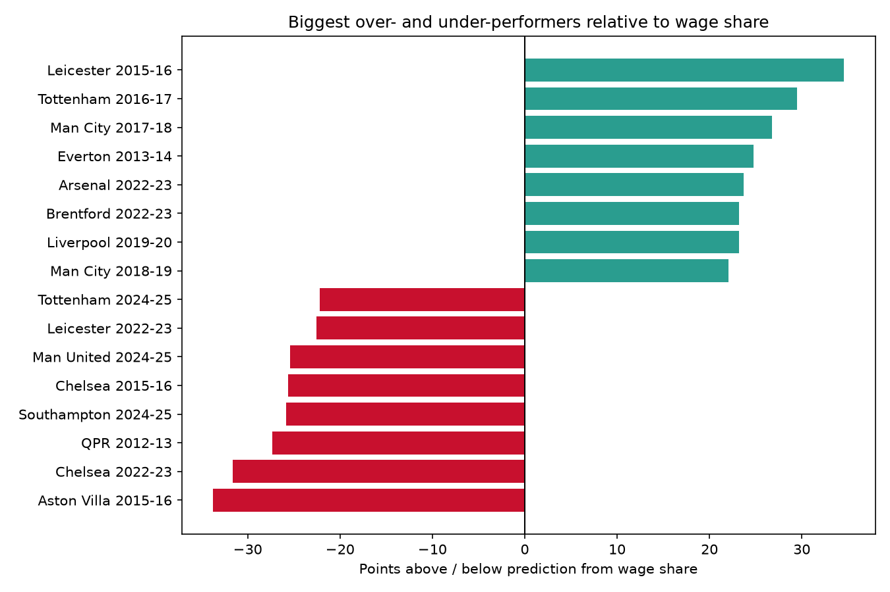

# Does Spending Buy Success?

Premier League wage bills, transfer spend and league performance, 2010-11 to 2024-25.

This project builds a dataset of every Premier League club-season from 2010-11 to 2024-25 (300 club-seasons), joining league results with transfer spending and hand-compiled wage bills. It then tests how closely a club's spending tracks its points total, and where that relationship breaks down.

## Key findings

- **Wages explain about 60% of the variation in points.** Across 300 club-seasons, a club's share of the league-wide wage bill has a correlation of 0.78 with its points (R² = 0.61). That leaves a lot unexplained: predictions on seasons the model had not seen were off by about 11 points on average.
- **Money mainly separates the top six from everyone else.** Clubs with the six highest wage bills averaged 73 points, against 46 for wage ranks 7-14 and 40 for ranks 15-20. The gap between the middle and the bottom is only about 6 points.
- **Outside the top six the relationship is much weaker.** Restricted to clubs ranked 7th-20th by wages, R² falls from 0.63 to 0.20. Part of this is mechanical (less spread in wages), so it shows weakening rather than a precise ratio.
- **Transfer spend adds almost nothing once wages are known.** Adding it moves R² from 0.610 to 0.617, and its coefficient is slightly negative (-0.55 points per percentage point of league transfer spend, 95% CI -1.05 to -0.06). I would not read that as "spending hurts": struggling clubs often spend heavily to recover.
- **A simple model does as well as a complex one.** On held-out seasons, a linear model on wage share (out-of-sample R² 0.60) matched a random forest on all three spending features (0.60).
- **The biggest misses are the famous ones.** Leicester 2015-16 finished 34.5 points above what their wage share predicts. Aston Villa 2015-16 and Chelsea 2022-23 finished about 34 and 32 points below.



## Research questions and answers

1. **Primary: does the wage-performance relationship hold across the whole table, or only at the extremes?** It is strongest at the extremes. The top six by wages are well separated from the rest, but inside each tier the correlation is modest (Spearman 0.32 to 0.38). See "Results" below.
2. **Which predicts points better, wage bill or transfer spend?** Wage bill, clearly. The two are correlated (r = 0.70) but not collinear enough to destabilise the model (VIF 1.95).
3. **Supporting: how much do clubs over- and under-perform their wages?** See the residual analysis and `figures/residual_outliers.png`.
4. **Not attempted (future work):** whether the relationship has changed over time as broadcast revenue grew. With 15 seasons this needs a proper structural-break test, not a trend line.

## Method

**Data.**

| Data | Source | How it is used |
|------|--------|----------------|
| Match results | [football-data.co.uk](https://www.football-data.co.uk/englandm.php) | Downloaded per season; league tables (points, goal difference, position) are derived from match results |
| Transfers | [eordo/transfermarkt-data](https://github.com/eordo/transfermarkt-data), built from Transfermarkt | Gross spend, gross income and net spend per club per season, in euros |
| Wage bills | Compiled by hand from the Guardian's annual Premier League finances review (2010-11 to about 2017-18) and Swiss Ramble (2018-19 onward) | One CSV per season in `data/raw/wages/`; sources listed in `data/raw/wages/SOURCES.md` |

**Comparing seasons.** Wage bills and transfer spend are expressed as each club's *share of that season's league-wide total*. This removes currency (wages are in pounds, transfers in euros) and inflation, so a 6% wage share in 2011 is directly comparable with 6% in 2024, without needing exchange-rate or CPI data. The cost is that absolute figures such as pounds per point are not available.

**Defining "top six".** Tiers are based on wage rank *within each season*, not on league finish. Splitting on finishing position would split on the outcome being explained, which mechanically weakens correlations inside each group.

**Inference.** Club-seasons are not independent (the same clubs appear repeatedly), so regression standard errors are clustered by club.

**Data quality.** The wage data is hand-entered, so `src/validate_data.py` checks for duplicates, incomplete seasons, missing values and suspicious year-on-year jumps in wage bills. Season totals were also compared with Deloitte's published league-wide wage totals; for example 2012-13, 2022-23 and 2023-24 agree to within about 1.5%. The results themselves act as a further check: the per-season correlations and the lists of over- and under-performers match well-known real events.

## Results

**Wage share and points.**

| Model | Coefficient | 95% CI | R² |
|-------|-------------|--------|----|
| Points ~ wage share (linear) | 5.09 points per percentage point | 4.34 to 5.84 | 0.610 |
| Points ~ log wage share | 28.29 | 24.52 to 32.06 | 0.625 |

In the log model, doubling a club's wage share goes with roughly 20 extra points (17 to 22 across the confidence interval). The log model fits only slightly better than the linear one, so I do not draw strong conclusions about diminishing returns.

**By wage tier.**

| Tier (by wage rank in the season) | Club-seasons | Mean points | Spearman, wage share vs points |
|-----------------------------------|--------------|-------------|-------------------------------|
| Top 6 | 90 | 73.0 | 0.35 |
| 7-14 | 120 | 46.3 | 0.32 |
| 15-20 | 90 | 40.0 | 0.38 |

**Season by season.** The correlation between wage rank and points ranges from 0.47 (2022-23) to 0.88 (2020-21), with a mean of 0.73. 2022-23 was weak because Arsenal and Brentford far outperformed their wages while Chelsea, on the second-highest wage bill, finished 12th.



**Robustness.**

| Check | Result |
|-------|--------|
| Drop the 10 largest outliers | R² rises from 0.625 to 0.685, slope unchanged |
| Clubs ranked 7-20 by wages only | R² 0.20, slope 20.3 (vs 28.3 overall) |
| Leave out each season in turn | Slope stays between 27.9 and 29.1 |
| Early (2010-11 to 2015-16) vs later seasons | R² 0.60 vs 0.65, so no sign the change of wage data source created a break |

**Predictive comparison (whole seasons held out).**

| Model | Out-of-sample R² | RMSE (points) |
|-------|------------------|---------------|
| Predict the mean | 0.00 | 17.7 |
| Linear, wage share only | 0.60 | 11.1 |
| Linear, wage share + transfer features | 0.61 | 11.0 |
| Random forest, three features | 0.60 | 11.3 |



## Limitations

- **Association, not causation.** Success also drives wages through bonuses, Champions League revenue and contract renewals, so wage share partly reflects results as well as buying them.
- **Two wage sources.** Wage figures come from the Guardian for early seasons and Swiss Ramble for later ones, and these may define "wages" slightly differently. The era comparison above shows no break, but it cannot rule out a small one.
- **Transfer fees are a partial picture.** They ignore wages, free transfers, loans and add-ons.
- **Effective sample size.** The 300 club-seasons come from about 15 seasons of repeat clubs, so there is less independent information than n = 300 suggests.
- **2025-26 excluded.** The season has finished but clubs have not yet published their accounts, so wage bills do not exist yet. Results and transfer data for 2025-26 are in the repo but not used in the wage analysis.
- **Hand-compiled data.** Wage figures were typed in manually. Checks are in place, but a small error in a single club-season would not necessarily be caught.

## Project layout

```
data/
  raw/results/        one CSV per season from football-data.co.uk
  raw/transfers/      one CSV per season from eordo/transfermarkt-data
  raw/wages/          hand-compiled wage bills, one CSV per season + SOURCES.md
  processed/          combined datasets and analysis_results.txt
figures/              charts produced by analysis.py
src/
  fetch_results.py          downloads season results CSVs
  load_results.py           combines seasons, derives final league tables
  load_transfers.py         spend / income / net per club-season
  load_wages.py             combines the wage CSVs, validates club names
  build_analysis_table.py   joins standings + transfers + wages
  validate_data.py          sanity checks on the combined table
  analysis.py               correlations, regression, model comparison, figures
```

## How to run

Requires Python 3.10+.

```
python -m venv venv
venv\Scripts\activate            # Windows (macOS/Linux: source venv/bin/activate)
pip install -r requirements.txt
python src/fetch_results.py      # needs internet access
python src/load_results.py
python src/load_transfers.py
python src/load_wages.py
python src/build_analysis_table.py
python src/validate_data.py
python src/analysis.py
```

`analysis.py` prints the full report, saves it to `data/processed/analysis_results.txt` and writes the figures to `figures/`.

## Status and next steps

- [x] Results, transfer and wage data pipelines
- [x] Validation checks
- [x] Correlation, regression, robustness and predictive analysis
- [ ] Within-club analysis: does a club do better in seasons when its wage share rises relative to its own norm? (club fixed effects)
- [ ] Table of clubs that persistently over- or under-perform their wages
- [ ] Add 2025-26 wage bills once accounts are published
- [ ] Test whether last season's wage share predicts this season's points better than this season's does

## Acknowledgements

Match data from [football-data.co.uk](https://www.football-data.co.uk). Transfer data from [eordo/transfermarkt-data](https://github.com/eordo/transfermarkt-data) and Transfermarkt. Wage figures from the Guardian's annual Premier League finances reporting and Swiss Ramble's analysis of club accounts.